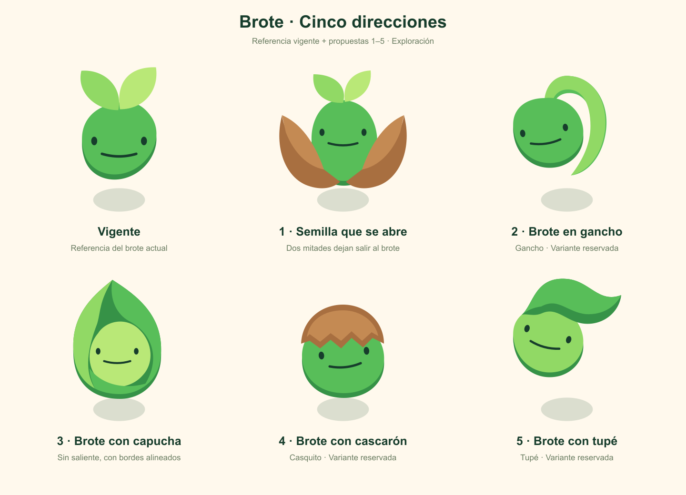
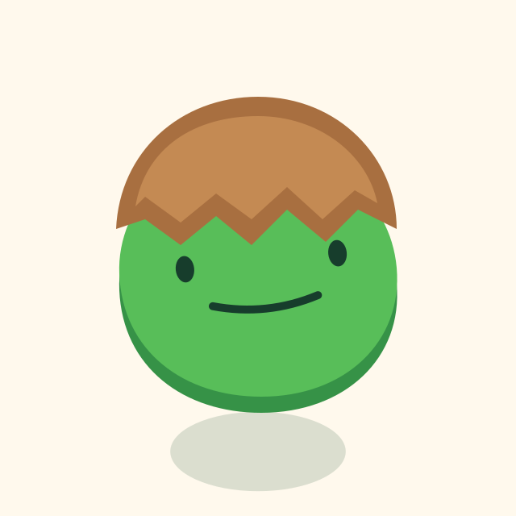
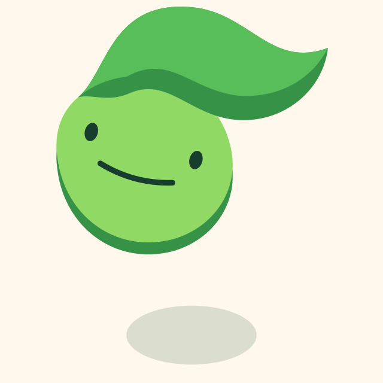

# Brote · Cinco direcciones

13 de octubre de 2026. Propuestas sin activar. El usuario descarta la primera ronda de variaciones por resultar demasiado parecidas. Esta ronda explora cinco conceptos de germinación, con diferencias de anatomía y postura.

- **1 · Semilla que se abre**: Dos mitades dejan salir al brote.
- **2 · Brote en gancho**: Gancho más fino, sin hojas y con punta.
- **3 · Brote con capucha**: Las hojas envuelven la cara.
- **4 · Brote con cascarón**: Cáscara centrada como casquito, sin hojas.
- **5 · Brote con tupé**: Variante aprobada, en lugar de Espiral.

Brote sigue siendo la etapa anterior a Plántula, con ID histórico `seedling`. Se reutiliza la geometría facial de `mascotFace`, con posición, escala uniforme y giro propios de cada propuesta. Colores planos tomados de Brote y Semilla, sin texturas ni degradados. La sombra de suelo permanece separada del cuerpo.

Cada propuesta dispone de un SVG completo y otro solo de cuerpo, fuera del registro de la app. El estudio HTML permite comprobar tamaños de 160, 100, 60 y 32 px, e iconos sin cara a 60 y 32 px. La referencia vigente permanece intacta.

## Refinamiento de la 4 · Casquito

A petición del usuario, se retiran las dos hojas y se coloca la cáscara sin inclinación, centrada sobre la cabeza. Se mantienen exactamente los trazados del cuerpo verde, su cara, colores y sombra. Propuesta en revisión, sin activar en la app.

Segundo ajuste: cáscara más pequeña, ceñida al contorno exacto de la cabeza. El borde superior comparte la silueta del cuerpo y no sobresale por ninguno de los lados. Se conservan cuerpo, cara y sombra.

Tercer ajuste: versión intermedia entre la cáscara amplia y la ceñida. Se recupera una bóveda baja sobre la cabeza y un pequeño saliente equilibrado a ambos lados, manteniendo el cuerpo y la cara.

El usuario aprueba la versión intermedia de Casquito. Se guarda por separado en [Variantes reservadas](brote-variations-future.md).

## Refinamiento de la 2 · Gancho

Se retiran las dos hojas y se sustituye el tallo grueso de extremo redondo por un gancho fino que acaba en punta. Se conservan exactamente la cabeza y la cara de la propuesta 2. Sigue en revisión.

Segundo ajuste del Gancho: versión intermedia, con algo más de grosor y borde verde oscuro, conservando el extremo único en punta. Sin hojas; cabeza y cara sin cambios.

## Derivación de la 2 · Supertupé

A propuesta del usuario, el gancho se recoge sobre la cabeza como un mechón vegetal con volumen, remate curvado y punta. Se conserva la cabeza y la cara de la 2; sin hojas añadidas. Variante aprobada y guardada por separado del Gancho; sustituye a Espiral en el puesto 5.

[SVG completo](brote-directions-2-tupe.svg) · [Cuerpo sin cara](brote-directions-2-tupe-body.svg).

Ajuste del Supertupé: su comienzo comparte un punto y la tangente del contorno superior izquierdo de la cabeza. El borde oscuro y el frontal confluyen allí, sin escalón. Se conservan el cuerpo, la cara y el remate del tupé.

El usuario aprueba Tupé como segunda variante reservada y lo sitúa en el puesto 5, sustituyendo a Espiral. Espiral conserva solo sus archivos históricos y queda retirada de la lámina y del estudio activos.

Tercer ajuste del Gancho: recuperación de la curva más marcada y del volumen de la idea inicial. El extremo se recoge algo más hacia la cabeza y mantiene una sola punta; sin hojas. Cabeza y cara conservadas.

Cuarto ajuste del Gancho: base en verde hoja `#58BE59`, frente al verde claro del Tupé. Cara algo más baja y a la izquierda: x=56, y=76, giro=−8°, escala=0,78. Se conservan la curva del gancho, el cuerpo, los ojos y la sonrisa comunes, y la sombra. No se modifica el Tupé reservado.

Quinto ajuste del Gancho: gancho en verde claro `#91D965`, con borde de verde hoja `#58BE59`. La curva se acerca a la base, con escala de 0,82 horizontal y 0,94 vertical alrededor de su arranque (58, 64). La base, la cara y la sombra permanecen iguales.

El usuario aprueba Gancho como tercera variante y se guarda por separado en Variantes reservadas.

## Refinamiento de la 3 · Capucha

Se retira el saliente derecho. La hoja izquierda y el borde inferior comparten segmentos exactos del contorno de la capucha, eliminando los desajustes. Se conservan la cara, la abertura clara y la sombra. Sigue en revisión.
