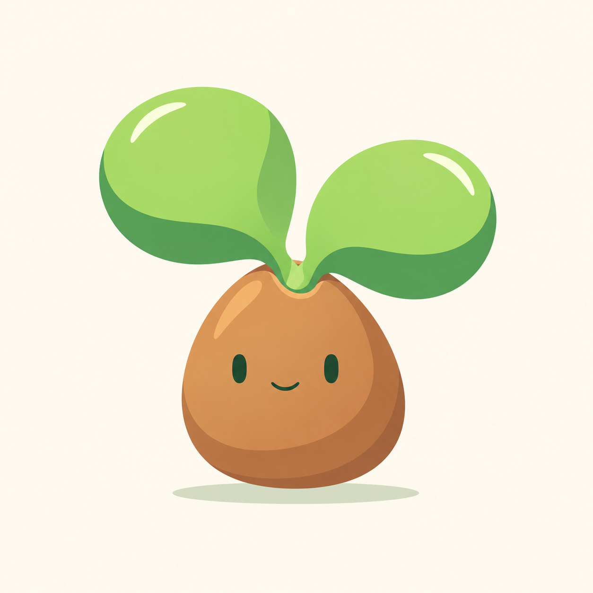

# Brote — B · Cotiledones

Propuesta creada desde cero el 13 de octubre de 2026. Pendiente de aprobación; no sustituye la mascota activa ni A · Tierra, aprobada como variante.

## Idea

Dos hojas casi circulares salen directamente de una semilla almendrada que conserva la cara. La apertura superior es suave y pequeña; no hay tallo visible ni montículo de tierra. La silueta es compacta y vertical, con hojas asimétricas y brillos blancos. Paleta y cara siguen la familia Reedleaves.

Generada desde cero con la herramienta integrada de imágenes, sin referencias de imagen como entrada, CLI ni API propia. La cara y las sombras forman parte de la exploración raster; su eventual implementación requiere separar cuerpo, cara compartida y sombra de suelo.

## Prompt utilizado

Use case: stylized-concept. Asset type: original Reedleaves Brote mascot concept B, one character. Generate a completely new compact friendly baby plant character on a plain warm cream #FFF9ED square background, clean generous margins. Concept: TWO very round fleshy green cotyledon leaves directly sprouting from the top opening of ONE plump golden-brown almond seed. The brown seed itself is the lower body and has the face. Silhouette is squat and cuddly, a rounded almond/pebble base about as wide as one leaf, with two almost circular broad green leaf discs spreading above it like a soft asymmetric pair of ears, one a little higher than the other. The leaf discs are rounded with a small tapered attachment at their bases, no pointed outer tips. The seed coat has ONE tiny smooth notch opening at its top, revealing a small lime green emergence between the two leaves; this is a split germinating seed, NOT an egg, not a bowl or flowerpot. Keep the seed body otherwise whole and uninterrupted across the face, with no vertical fracture. NO visible vertical stalk or stem; the leaves meet the seed opening directly. Face on brown seed only: two SMALL equal dark forest-green #173D2C solid vertical oval eyes far apart, no pupils or glints, and a tiny thin shallow curved closed smile below them, no cheeks, brows, nose or open mouth. Fresh green palette #B9E877 #83BD4D #58BE59 and only ONE darker green shadow plane #369247 at the bottom/side of each leaf. A small smooth curved ivory-white crescent highlight near each leaf's top edge. Broad warm brown seed colors #C48A53 and #A86F40 with one lighter front plane and a subtle darker lower/side shape, clean smooth organically rounded silhouette. Minimal flat vector-like rendering, simple confident shapes, playful friendly mobile mascot personality, visual clarity at small sizes. ONE shadow shade per leaf, no second outer dark strip or thick outline. Keep leaf area and seed body balanced; total leaf width about 1.8 times seed width, total character height about 1.2 times total width. Separate subtle pale green-gray ground ellipse below character with a tiny floating gap. A single centered character, no text/labels, no soil mound, pot, roots, book, arms, legs, stones, flowers, sparkles, other characters, or props. No 3D, photorealism, realistic texture, noise, dramatic gradients, black outlines or glossy plastic. This is a fresh independent design, not a variation on leaves atop a wide soil mound.
