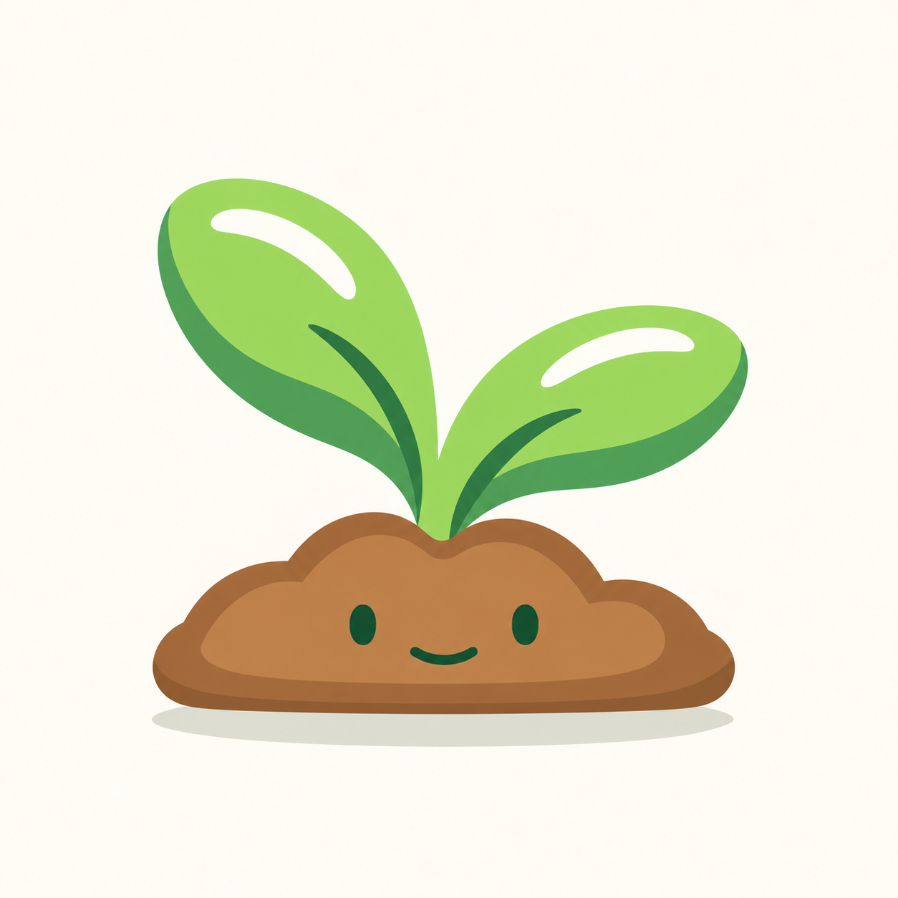

# Brote — A · Tierra

Primera propuesta, 13 de octubre de 2026. **A · Tierra, versión v3, aprobada por el usuario como variante.** Guardada en el estudio; no modifica la mascota activa ni sus calibraciones.

La versión conservada es `brote-variations-a-tierra-v3.png`: recorta la segunda franja exterior, la más oscura, de ambas hojas, dejando fondo en su lugar. Las hojas quedan más finas y mantienen la sombra verde interior, las nervaduras y los brillos. Tierra y cara se conservan. `brote-variations-a-tierra.png` guarda la primera propuesta como referencia. La v2 queda como revisión superada: había recoloreado la franja en verde intermedio, que no era el cambio pedido.

## Composición

Otra idea creada desde cero: [B · Cotiledones](brote-variations-b-cotiledones.md), pendiente de aprobación.

- Dos hojas ovaladas y redondeadas, con luces blancas y sombras verdes oscuras.
- Hojas que nacen directamente del montículo, sin tallo vertical visible.
- Tierra marrón baja, de lóbulos suaves, con ojos separados y sonrisa pequeña.
- Sombra de suelo independiente visualmente.

## Referencias y generación

La primera imagen del usuario aporta la idea de brote con tierra. La segunda es la referencia principal para hojas, brillo y sombra. Las láminas de Semilla y Maceta de Reedleaves aportan paleta, acabado y lenguaje facial.

Generada con la herramienta integrada de imágenes, sin CLI ni API propia. Esta imagen raster es una exploración. Si se elige para la app, habrá que separar cuerpo, cara común y sombra de suelo y verificar los tamaños de producto. La imagen contiene transiciones suaves de color y la cara es una aproximación visual, no la geometría SVG exacta.

## Prompt de revisión v3

Edición localizada con la herramienta integrada de imágenes, partiendo de la primera propuesta.

Use case: precise-object-edit. Perform a strictly localized silhouette cut on this exact image. The user wants the darkest OUTERMOST strip of both leaves DELETED, not recolored. Each original leaf has a lime front plane, a medium green shadow plane, and an outer darker green strip along the bottom/outer perimeter. ERASE that final darkest outer strip entirely and restore the same warm cream background in the erased region. Thus the leaf outer silhouette must become physically smaller/thinner along that edge, following exactly the existing boundary between the medium green and the darkest green. The medium green shadow region must keep its ORIGINAL area, thickness, shape and color; it must NOT expand into the deleted outer strip. Do NOT fill the darkest region with medium green, do NOT blend the strips together, do NOT create a replacement rim. On the LEFT leaf, cut away the dark strip following its lower-left curved perimeter, exposing background and keeping the original medium green curved shape. On the RIGHT leaf, cut away the darkest band under its medium green lower shadow, exposing background and preserving that medium green shadow exactly. Preserve the original lime green upper leaf planes, both white highlights, the two dark green INNER vein strokes, and the central green attachment to the soil. Do not erase the inner veins just because they are dark. Keep the full soil mound, brown shading, eyes, smile, ground ellipse, layout, scale, background and all non-target image areas unchanged as closely as possible. No new text or elements. Required visible result: slimmer leaves, narrower overall shaded underside, ONLY the removed outer strips become background. Use the original supplied first image as the edit target.

## Prompt de revisión v2

Revisión superada por v3; no representa la versión reservada actual.

Edición localizada con la herramienta integrada de imágenes, usando la primera propuesta como única referencia.

Use case: precise-object-edit. Edit this exact Reedleaves Brote mascot illustration. Make ONLY this localized change: remove the SECOND, OUTERMOST, DARKEST GREEN shadow strip/rim on BOTH leaves. Currently each leaf has three main color bands: lime green front, medium green broad underside shadow, and a second even darker green band following the outside lower perimeter. Remove that final darkest outer perimeter band by blending/recoloring it to the adjacent MEDIUM GREEN shadow, so each leaf has only its lime green face and ONE medium green underside shadow area, with NO additional darker outer rim. Keep the broad medium green inner shadow, the dark green interior curved vein on each leaf, and both white highlights exactly as they are. Preserve the full existing outer leaf silhouette, leaf sizes, orientation, placement, their direct attachment to soil without stem, the entire brown soil mound including its own brown shading/edges, eyes, mouth, separate ground ellipse, warm cream background, framing, resolution, texture and all other pixels as closely as possible. Do not redraw, redesign, simplify, resize, crop, or change any other part. No text. Output the same complete illustration with only those two darkest outer leaf bands removed.

## Prompt original

Use case: stylized-concept. Asset type: one first Reedleaves Seedling / Brote mascot concept. Transform the plant-and-soil reference into our mascot family. Input image 1: the user's simple sprout silhouette concept only. Input image 2: PRIMARY shape and lighting reference, especially the colored plant on its LEFT: two broad rounded oval leaves with bright WHITE crescent highlights near their upper edges and distinctly darker lower shadow planes. Input image 3: Reedleaves seed family style and FACE reference. Input image 4: Reedleaves current flowerpot family, warm brown soil and soft clean flat rendering reference. Produce ONE centered large friendly seedling mascot on a plain warm cream #FFF9ED square backdrop with generous clear margins. Composition: exactly TWO plump round-ended green leaves, left leaf a little taller, right leaf wider and lower, tilted outward forming a compact open V. Broad simple white curved highlight on each leaf, clean large flat forest-green shadows along the lower portions, leaf colors fresh #B9E877 and #83BD4D with darker #369247 planes. Follow image 2 very closely in rounded leaf geometry and white highlight/dark shadow design, but soften the hard dark outline into the Reedleaves colored offset edge/shadow; no heavy black or brown contour. A single simple dark green gently curved inner vein per leaf is allowed, no intricate venation. The leaves emerge directly from the TOP CENTER of a low softly lobed WARM BROWN SOIL MOUND, their bases visually touch the soil, with NO VISIBLE VERTICAL STEM and no gap above the soil. The soil is a wide low domed mound with rounded side humps and a smooth lower edge, warm brown #A86F40 / #C48A53 planes, broad darker lower edge, clean flat colors. Put the FACE ON THE SOIL ONLY, clearly centered in the front brown plane: two small dark forest-green vertical oval eyes, equal size and widely separated, no pupils/highlights; one small shallow closed curved smile, much narrower than the eye spacing (the approved Brote smile is just 16 units wide when the eyes are 58 units apart). Simple friendly family face; no eyes or mouth on leaves. A subtle pale green-gray elliptical ground shadow floats separately below the mound with a small gap. The soil face must remain easily readable, no pebbles or decorations in its facial area. Polished flat vector-like mascot art with smooth curves and minimal color planes, expressive like the supplied Reedleaves family. No photorealism, no 3D, no gradient gloss, no grain or texture, no arms, legs, pot, stones, book, flowers, sun rays, sparkles, text, labels, logos, watermarks, or extra characters. The output is a NEW unselected concept derived from the references; retain their roles, do not reproduce the reference sheet.
