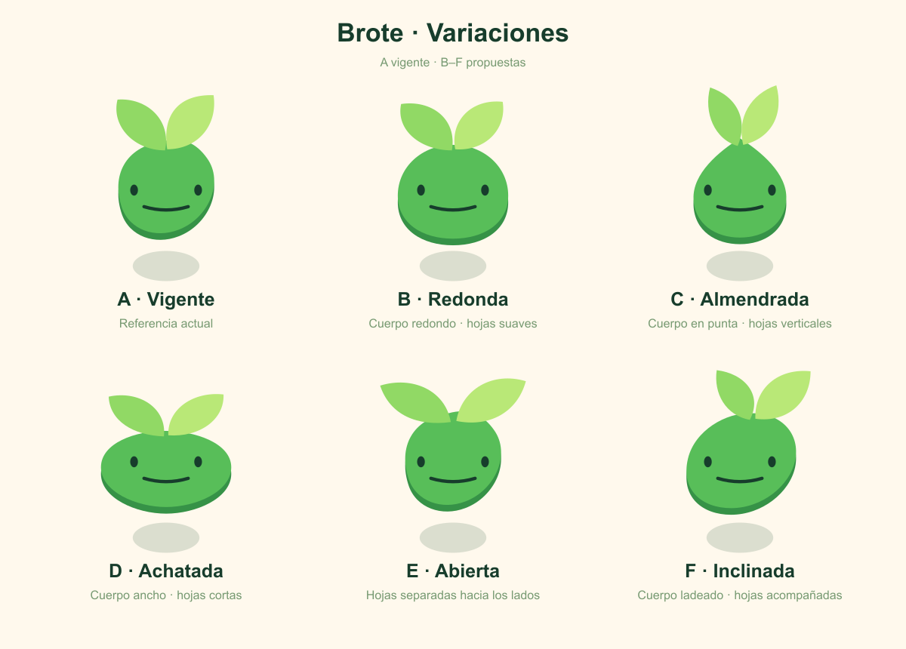

# Variaciones de Brote

13 de octubre de 2026. Propuestas; no sustituyen el arte activo.

Brote es la etapa de tres días, entre Raíz y Plántula. Conserva el identificador histórico seedling. La referencia A procede exactamente de bodies/seedling.svg y de la cara común vigente.

| Variante | Cambio propuesto |
| --- | --- |
| A · Vigente | Referencia actual. |
| B · Redonda | Cuerpo redondo · hojas suaves. |
| C · Almendrada | Cuerpo en punta · hojas verticales. |
| D · Achatada | Cuerpo ancho · hojas cortas. |
| E · Abierta | Hojas separadas hacia los lados. |
| F · Inclinada | Cuerpo ladeado · hojas acompañadas. |

Todas comparten los cuatro colores planos de A, la misma cara, ojos separados, sonrisa de 5×, colocación y sombra independiente. No se han añadido texturas, degradados ni accesorios. Las hojas y la silueta del cuerpo son las únicas piezas exploradas.

La lámina editable está en brote-variations-exploration.svg. El estudio brote-variations-exploration.html muestra cada propuesta a 160, 100, 60 y 32 px y el cuerpo sin cara como icono a 60 y 32 px. Cada propuesta dispone de un SVG completo y otro solo de cuerpo; estos archivos permanecen fuera del registro de mascotas del producto.
