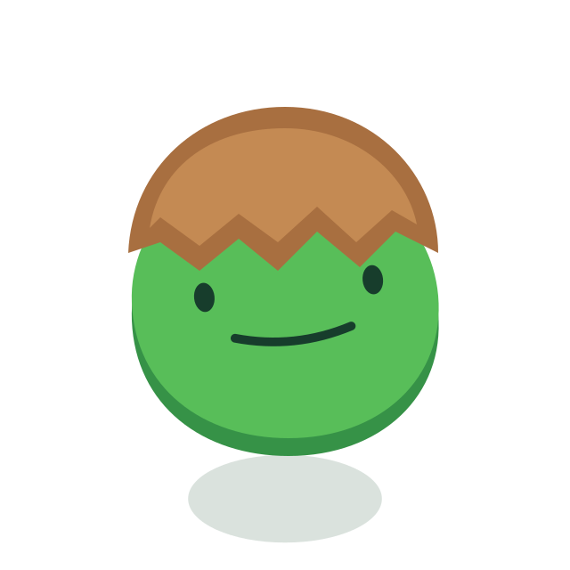

# Brote · Variantes reservadas

13 de octubre de 2026. El usuario aprueba Casquito, Tupé y Gancho como variantes reservadas. El brote activo de producción se conserva.

## Casquito

Sin hojas, cuerpo verde redondeado y cáscara centrada con un pequeño saliente equilibrado a ambos lados. Se conserva exactamente la versión intermedia aprobada, sin cambios de cuerpo, cara, colores o sombra.

- [Personaje completo, SVG](brote-variations-casquito.svg).
- [Personaje completo, PNG transparente](brote-variations-casquito.png).
- [Cuerpo sin cara ni sombra, SVG](brote-variations-casquito-body.svg).

Cara común de `seedling`, colocación x=81, y=90, giro=−6°, escala=0,82, ojos sin desplazamientos y boca de 5×. El personaje completo tiene desplazamiento vertical −9 unidades y sombra de suelo independiente. Estos valores pertenecen a esta variante reservada, no a la mascota activa.

## Tupé

Segunda variante aprobada. Sustituye a Espiral en la colección de propuestas. Se conserva exactamente el tupé con su comienzo alineado al contorno de la cabeza, el remate en punta y la cara de la propuesta 2. Sin hojas añadidas.

- [Personaje completo, SVG](brote-variations-tupe.svg).
- [Personaje completo, PNG transparente](brote-variations-tupe.png).
- [Cuerpo sin cara ni sombra, SVG](brote-variations-tupe-body.svg).

Cara común de `seedling`, colocación x=60, y=70, giro=15°, escala=0,78, ojos sin desplazamientos y boca de 5×. Desplazamiento vertical del personaje −9 unidades; sombra separada. Valores propios de la variante, sin activar en producción.

## Gancho

Tercera variante aprobada. Gancho claro y compacto alrededor de la base verde hoja; sin hojas y terminado en una sola punta. Se guarda exactamente la última versión aprobada.

- [Personaje completo, SVG](brote-variations-gancho.svg).
- [Personaje completo, PNG transparente](brote-variations-gancho.png).
- [Cuerpo sin cara ni sombra, SVG](brote-variations-gancho-body.svg).

Cara común de `seedling`: x=56, y=76, giro=−8°, escala=0,78 y boca de 5×. Gancho con escala 0,82 horizontal y 0,94 vertical alrededor de (58, 64). Desplazamiento del personaje −9 unidades y sombra separada. Variante reservada, sin activar en producción.
