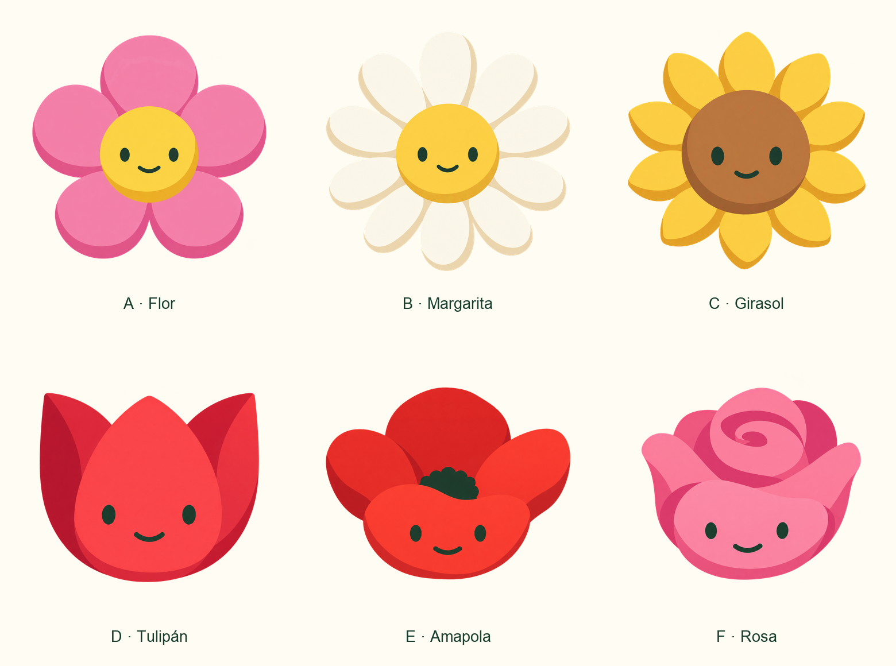
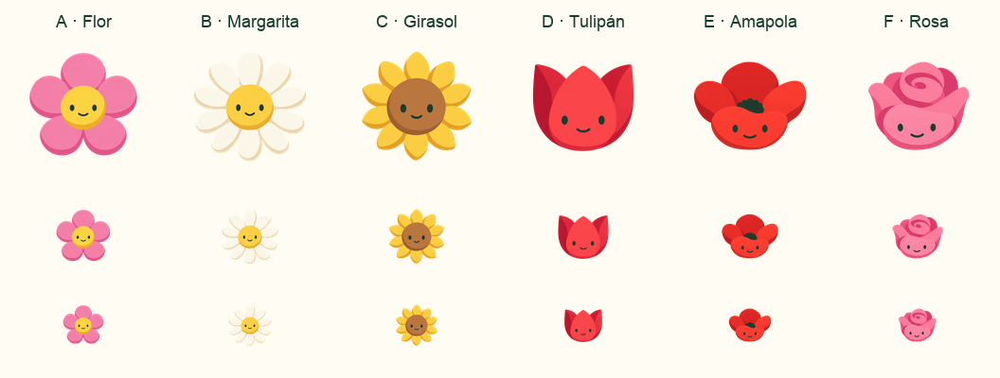

# Flor sin tallo · estilo Plántula

Segunda serie de exploraciones · 15 de octubre de 2026. **A · Flor elegida para la app**, como siguiente desbloqueo tras Tallo a los **15 días distintos de gasto de hojas por libro**. Las variantes B–F se conservan para otro momento.

Petición del usuario: rehacer las seis flores mostrando **solo la flor**, sin tallo, y centrarse mucho más en el estilo de la mascota Plántula. La [serie anterior se conserva como «estilo tallo»](../flower-variations/README.md), con todas sus imágenes originales.

| Variante | Forma |
| --- | --- |
| [A · Flor](a-flor-default.png) | Flor genérica muy elemental: cinco pétalos rosas y centro amarillo. |
| [B · Margarita](b-margarita.png) | Corona de pétalos blancos alargados y centro amarillo. |
| [C · Girasol](c-girasol.png) | Pétalos amarillos apuntados alrededor de un gran disco marrón caramelo. |
| [D · Tulipán](d-tulipan.png) | Copa roja de tres lóbulos, con la cara en el pétalo frontal. |
| [E · Amapola](e-amapola.png) | Pétalos rojos abiertos, centro oscuro y cara en un pétalo rojo. |
| [F · Rosa](f-rosa.png) | Roseta rosa con pliegues amplios y una espiral sencilla. |

## Referencia y criterio de esta serie

La única referencia de imagen es la **Plántula activa**, renderizada desde `../bodies/sprout.svg` con la cara compartida de `app/mascot-face.mjs`. Se conserva como [SVG](reference-plantula.svg) y [PNG](reference-plantula.png). No se han usado Tallo, la Plántula con tierra ni las flores anteriores como referencias de generación.

Se pide trasladar su simplicidad gráfica: formas orgánicas grandes, colores principales sencillos, pocas sombras de color y cara mínima verde oscura. Las hojas de Plántula son una referencia de lenguaje visual; no se añaden como partes de estas flores.

Cada personaje termina en sus propios pétalos. No lleva tallo, cuello, cuerpo verde inferior, hojas laterales, sépalos, raíces, tierra o maceta. La flor ocupa todo el personaje.

## Revisión

La lámina permite comparar las seis a tamaño grande y la segunda muestra 128, 64 y 48 px. Los archivos individuales conservan transparencia y la composición no retoca el arte original.

Comprobadas las seis: solo flor, sin tallo ni hojas; cara legible, silueta completa y transparencia en todos los PNG (1254 × 1254 px). A conserva el arquetipo más elemental; D tiene la silueta más compacta. La margarita pierde algo de contraste sobre crema. Girasol y amapola mantienen ahora la cara legible gracias al disco más claro y al pétalo frontal, respectivamente.

El acabado elimina los grandes brillos blancos de la serie anterior y simplifica los planos. Las imágenes todavía presentan algunas transiciones suaves de tono; no son una reproducción literal de los colores completamente planos del SVG de Plántula.

Estas imágenes son propuestas raster, con una cara aproximada a la compartida. Una elección de producto requerirá preparar cuerpo, cara y sombra independientes.

## Generación y archivos

Generadas con **imagegen integrado**, una llamada independiente por flor. Los seis prompts completos están en [prompts.json](prompts.json). El [script de composición](compose.py) crea las dos láminas a partir de los originales. Para integrar A, otra edición localizada eliminó únicamente su cara: [prompt de preparación](body-preparation-prompt.txt). El cuerpo está en `../bodies/flower.png`; la app superpone la cara SVG compartida y la sombra independiente.

La serie anterior sigue disponible en su [documento «estilo tallo»](../flower-variations/README.md). No se ha incorporado ningún selector de variantes.
