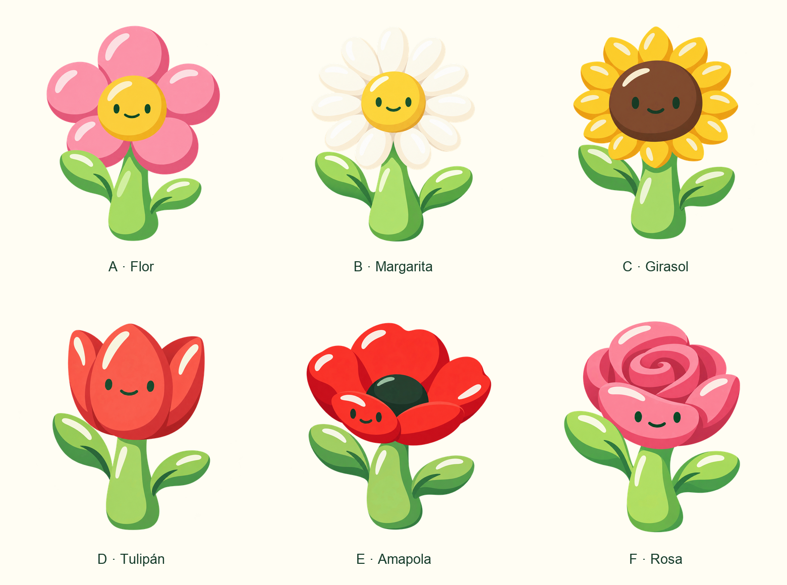
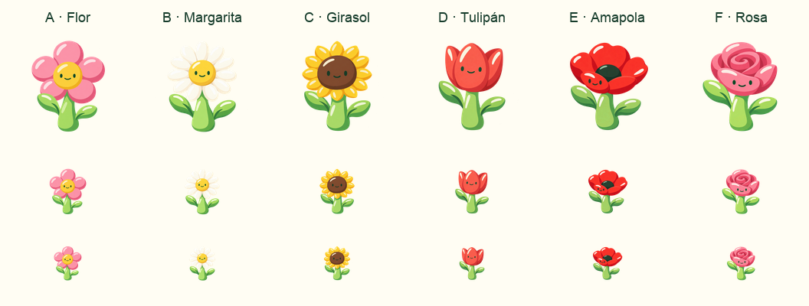

# Flor: seis exploraciones · estilo tallo

Propuestas del 15 de octubre de 2026. Pendientes de elección. No están integradas ni cambian etapas o umbrales.

Serie conservada por petición del usuario como **«estilo tallo»**. La nueva exploración de Flor debe mostrar solo la flor, sin tallo, y acercarse mucho más a la Plántula activa: [Flor sin tallo · estilo Plántula](../flower-only-variations/README.md). Los originales de esta serie se conservan sin cambios.

| Variante | Propuesta | Valoración |
| --- | --- | --- |
| [A · Flor](a-flor-default.png) | Cinco pétalos rosas redondos y centro amarillo. Especie genérica. | Mi elección por defecto: la flor más elemental e inequívoca. Amable y muy legible. El color rosa no pretende convertirla en una rosa de especie. |
| [B · Margarita](b-margarita.png) | Corona blanca de pétalos alargados y centro amarillo. | Reconocible y cercana a A, con más pétalos. El blanco pierde fuerza sobre crema: convendría reforzar ligeramente el tono de sombra del borde si se elige. |
| [C · Girasol](c-girasol.png) | Gran disco marrón y corona amarilla de pétalos apuntados. | Especie inmediata y silueta fuerte. El centro grande la diferencia de la margarita. Aclararía algo el disco para mejorar el contraste de los ojos en pequeño. |
| [D · Tulipán](d-tulipan.png) | Copa roja de tres lóbulos verticales. | La alternativa más simple y distinta de las flores radiales. Muy buena lectura de especie y de cara. |
| [E · Amapola, v2](e-amapola-v2.png) | Copa roja abierta, pétalos anchos y centro oscuro. Cara en pétalo frontal. | La cara original en el disco oscuro se perdía; v2 la traslada a un pétalo rojo y mejora claramente. Es más expresiva y asimétrica. Si se elige, reduciría el número de planos de pétalo para acercarla más a Plántula. |
| [F · Rosa](f-rosa.png) | Corola rosa con espiral central y pétalo frontal ancho. | Especie reconocible, cara clara y personalidad fuerte. Tiene más detalle que el resto; simplificaría un nivel de pliegues para el arte final. |

## Familia estética y límites

La referencia principal de forma fue la **Plántula activa** (`../bodies/sprout.svg`, ID histórico `sprout`). La referencia de acabado fue `../plantula-variations-a-tierra-v3.png`, una exploración reservada, no un diseño activo. Tallo (`../bodies/stem.png`) aportó secundariamente el tallo carnoso y las hojas laterales.

Se conservaron hojas grandes, siluetas amables, caras mínimas y brillos amplios. Estas propuestas raster tienen más volumen y degradado que la Plántula activa. Tras elegir una dirección, habría que ajustar ese acabado y separar cuerpo, cara y sombra con el componente común. No deben interpretarse como aprobación de una nueva técnica de arte.

La geometría exacta de pétalos en las imágenes generadas es orientativa. La amapola tiene más planos visibles que los cuatro solicitados; la revisión final debería reducirlos. El reconocimiento de la especie aquí se apoya en la copa abierta roja y el centro oscuro.

## Comprobación visual

Revisadas las seis imágenes individualmente, sobre fondo crema y a 128, 64 y 48 px. A y D conservan mejor la claridad. B necesita más separación del fondo; C mejoraría con disco más claro. E v2 mantiene cara visible sobre rojo; F conserva la espiral, aunque se vuelve más densa al reducirla.

Los PNG individuales conservan transparencia. La lámina solo escala y compone; no retoca el arte. El [script de composición](compose.py) permite regenerarla.

## Generación y trazabilidad

Se usó **imagegen integrado**, una llamada por variante y una edición adicional de E. No se usó la API CLI. Los seis prompts completos están en [prompts.json](prompts.json). El prompt de la corrección está en [e-amapola-v2-prompt.txt](e-amapola-v2-prompt.txt). Se conserva [E original](e-amapola.png) para comparar.

Referencias de cada llamada, en este orden:

1. `reference-plantula-body.png`: rasterización sin modificaciones de Plántula activa.
2. `../plantula-variations-a-tierra-v3.png`: referencia de acabado y carácter.
3. `../bodies/stem.png`: referencia secundaria.

La edición de E solo usó `e-amapola.png` como objetivo.

La [propuesta sobre líneas paralelas](../parallel-mascots-proposal.md) es un documento de producto separado y también pendiente. Estas seis flores pueden servir como apariencias del mismo nivel; esta exploración no decide sus desbloqueos.
