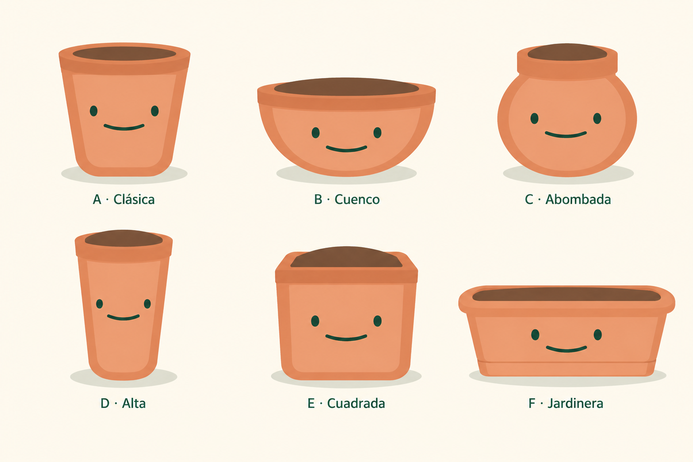

# Propuestas de Maceta — segunda lámina

12 de octubre de 2026. Segunda revisión conservada como historial. El archivo vigente está en [Macetas reservadas para el futuro](pot-variations-future.md), con un ajuste posterior del borde de A. La app conserva su maceta vigente.

| Variante | Forma y revisión |
| --- | --- |
| A · Clásica | Cuerpo cónico y base redondeada. Abertura oval coherente, tierra dentro y borde delantero visible. |
| B · Cuenco | Baja y ancha, con base curva. Conservada. |
| C · Abombada | Cuerpo redondo y boca más estrecha. Conservada. |
| D · Alta | Cuerpo esbelto, ligeramente cónico. Conservada. |
| E · Cuadrada | Frente amplio y esquinas suaves. Conservada por indicación del usuario. |
| F · Jardinera | Sustituye a Asimétrica. Recipiente rectangular ancho y bajo, bordes suaves, paredes ligeramente inclinadas hacia dentro y banda inferior discreta. |

## Criterio de la revisión

En A, la tierra anterior formaba un montículo elevado sin una abertura que explicara su volumen. Parecía una pieza marrón puesta encima del borde. La versión nueva representa la tierra como una superficie oval interior, rodeada por el labio de terracota y parcialmente oculta por el borde delantero. Así comparte la perspectiva de las demás macetas.

F utiliza la silueta de la referencia aportada por el usuario: [jardinera rectangular](pot-planter-reference.png). Mantiene los colores terracota y el acabado ilustrado de la familia, con ojos separados y sonrisa verde.

La primera lámina `pot-variations-exploration.png` se conserva como historial. La Asimétrica se retira de las propuestas vigentes. La revisión no selecciona todavía ninguna maceta para el producto.

## Generación y comprobación

Edición con la herramienta integrada de imágenes, sin CLI ni API propia. Referencias: la primera lámina y la fotografía de la jardinera. Revisada visualmente: A tiene una abertura oval con tierra interior; F es una jardinera rectangular; B, C, D y E mantienen sus diseños.

Prompt utilizado:

Use case: precise-object-edit. Edit image 1, the six-pot mascot exploration sheet, with ONLY two local changes. Image 2 is a SHAPE reference for the replacement of F, not a rendering style reference. Preserve the original sheet's exact canvas, 3 by 2 layout, cream background, positions, shadows, lettering style, terracotta palette, and minimal vector-like friendly art. Keep B Cuenco, C Abombada, D Alta and E Cuadrada EXACTLY unchanged including their soil, rim, bodies, faces, proportions and labels. Do not make unrequested fixes to E.
CHANGE 1, top-left A Clásica: preserve its existing tapered terracotta body, size, base, inset front plane, eyes and smile. Fix ONLY its opening / rim / visible soil. The existing brown domed mound bulges up above the rim and looks like a brown cutout stuck on top of a flat band. Replace that with a believable coherent shallow oval opening viewed slightly from above, like the openings of B C D. The brown soil must be a flat elliptical surface INSIDE the pot, a little recessed below the rim, fully framed by a thin terracotta BACK lip and curved FRONT lip. The front rim must visibly occlude the front edge of the soil so the opening reads as a hollow vessel with depth. No mound, no hump, no triangle or trapezoid of soil above the back edge. No brown soil exposed outside the opening. Give A a simple smooth slightly rounded rim but preserve its classical silhouette below the rim and leave its face and label 'A · Clásica' unchanged.
CHANGE 2, bottom-right F: remove the entire Asimétrica pot, replace it with a 'Jardinera' mascot based on image 2's wide rectangular planter. Shape: wide low horizontally elongated rounded rectangular container, overall width about 2.2 times height, long nearly horizontal top lip with gently rounded end corners, tapered sidewalls angled inward toward a slightly narrower straight base, a modest simple horizontal base band like reference 2. Clean symmetric FRONT-ON body with a little top-down perspective revealing the long shallow rounded-rectangle opening, brown soil INSIDE below the rim. Top rim should clearly surround the soil and cover its front edge. Preserve the sheet's illustration style: same terracotta outer body #D98B62, warm light peach-terracotta inset front #E8A078, darker clay edge #B96E4D, brown soil #73513B; no bright plastic orange from the photo. No photorealism, no plastic gloss, no detailed texture, no black outline. Fit within F's existing grid cell, retain the same row baseline and enough whitespace. Its face matches the other five: only two small far-apart dark forest-green vertical oval eyes and one thin wide shallow curved closed smile, centered on the broad front below the rim. No eyebrows, blush, pupils or extra facial elements. Replace F's label with EXACT text 'F · Jardinera', same font size/color and baseline as existing label. Remove the word Asimétrica entirely. The new character has the same subtle green-gray ground shadow as the other five.
Invariants: A's body and face unchanged; B C D E completely untouched; same six-letter A B C D E F order, same original artwork quality and family coherence; no plants, seeds, sprouts, leaves, legs, handles, decorative drawings, extra text, slogans or other elements. Produce the edited sheet, not the reference photo.
