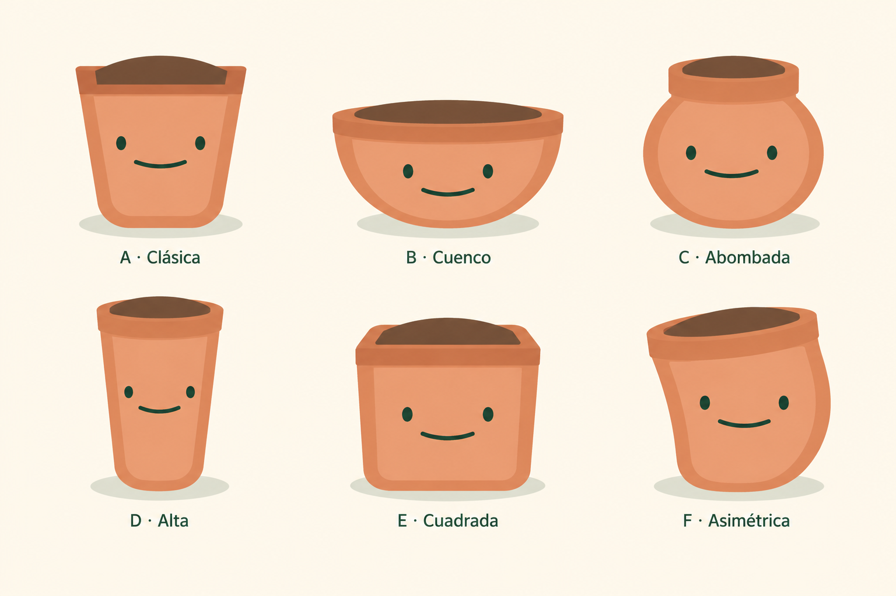

# Propuestas de Maceta

12 de octubre de 2026. Primera exploración conservada como historial. El archivo vigente está en [Macetas reservadas para el futuro](pot-variations-future.md): corrige la tierra y el borde de A y sustituye F · Asimétrica por F · Jardinera. La maceta vigente de la app conserva su arte.

| Variante | Forma |
| --- | --- |
| A · Clásica | Cercana a la actual; cuerpo cónico y base redondeada. |
| B · Cuenco | Baja y ancha, con base curva. |
| C · Abombada | Cuerpo redondo y boca más estrecha. |
| D · Alta | Cuerpo esbelto, ligeramente cónico. |
| E · Cuadrada | Frente amplio y esquinas suaves. |
| F · Asimétrica | Borde inclinado y cuerpo de curvatura desigual. |

## Referencia y revisión

La referencia se rasterizó desde los cuerpos vigentes de `bodies/`, las caras de `app/mascot-face.mjs` y las colocaciones de `app/mascot-art.css`. Incluye la semilla almendrada aprobada y la calibración vigente de Raíz. Las propuestas mantienen terracota, frente claro, borde oscuro, tierra visible, ojos separados y sonrisa verde. No incorporan plantas ni accesorios. Las seis formas se revisaron visualmente en la lámina.

Generación con la herramienta integrada de imágenes, sin CLI ni API propia. La cara generada es una referencia de concepto; cualquier integración elegida deberá recuperar la cara SVG común exacta y la sombra independiente de la app.

## Prompt utilizado

Use case: stylized-concept. Asset type: ONE landscape character exploration sheet of SIX different flowerpot mascot body shapes in a spacious 3-column by 2-row grid. The supplied image is the CURRENT APPROVED Reedleaves mascot family, with the terracotta flowerpot at far left, newly selected almond-shaped brown seed, ginger root, green seedling and two-leaf sprout. Match this family's art style closely. We are exploring the FLOWERPOT only, not the other characters. Same warm terracotta colors #D98B62 outer clay, #E8A078 inset front plane, #B96E4D darker rim and simple clay shadow, #73513B visible soil. Very simple clean vector-like shapes, flat fills with only broad soft depth planes, no black outlines, no detailed textures, no realistic pottery photography, no glossy 3D. Each pot contains a simple dark-brown visible soil surface at the top, with no plant, seed, sprouts, leaves or roots visible. No extra objects. The personality must come from the vessel silhouette alone.
Design exactly SIX clearly distinct pots, not six variations of the same trapezoid:
A, top left, 'A · Clásica': closest to the current approved pot. Friendly medium-height truncated-cone silhouette, wider at top and narrower at bottom, softly rounded bottom corners, a clearly defined modest outward top lip and brown soil.
B, top center, 'B · Cuenco': notably squat wide bowl flowerpot, width roughly 1.7 times height, smooth curved bowl bottom, a simple broad oval opening and small shallow rim. Keep enough central front space for the face.
C, top right, 'C · Abombada': round-bellied bulbous little planter, almost spherical body with a narrower neck/opening and short rim, like a soft plump terracotta jar with no handles.
D, bottom left, 'D · Alta': tall slim planter, height about 1.5 times width, slightly tapered nearly straight sidewalls, soft rounded base and compact rim. Face must fit across the narrower body, keep small eyes and proportions consistent with the family.
E, bottom center, 'E · Cuadrada': a distinctly square planter with generously rounded corners, gently curved square rim in simple perspective and a broad flat front surface; box-like proportions are visibly different from A. No legs or feet.
F, bottom right, 'F · Asimétrica': a playful gently skewed pot, one side softly bulging and the opposite side tapering inward, subtly tilted uneven rim, rounded lower body, whole pot upright and stable. A sculptural friendly vessel, not broken, not cracked, not melted, no chips. Clearly asymmetrical silhouette without accessories.
Facial invariants for ALL: two SMALL dark forest-green #173D2C vertical oval eyes, horizontally far apart, same eye size and one thin broad SHALLOW CLOSED smile below the eyes, exactly the family reference. Eyes have no white, pupils or highlights. No nose, eyebrows, blush, cheeks, teeth or open mouth. One face on the body below the rim, never on the soil. Match face proportions and calm happy expression across all six rather than varying facial expressions.
Composition: six large evenly spaced isolated characters, each given equal visual importance despite different aspect ratios, no overlaps, generous outer and inner margins, one plain warm cream #FFF9ED background. Below each body an identical low-opacity green-gray ground ellipse, separate from the body, no extra shadows or panels. ONLY the six small functional labels specified above, in dark forest-green centered beneath each character. No title, no slogans, no descriptions, no borders or decorative elements. Keep the original warm expressive family feeling and strong readable silhouettes at small sizes.
