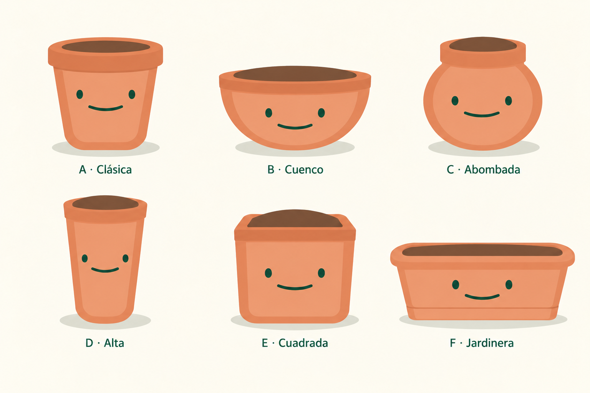

# Macetas reservadas para el futuro

12 de octubre de 2026. Colección de seis variantes, conservada por indicación del usuario después de las revisiones. No se ha elegido un nuevo cuerpo de maceta para integrar en la app.

| Variante | Forma y ajustes conservados |
| --- | --- |
| A · Clásica | Cuerpo cónico y base redondeada. Tierra interior oval, borde superior ligeramente saliente por ambos lados y banda delantera más baja que tapa las uniones angulosas del cuerpo. |
| B · Cuenco | Cuerpo ancho y bajo con base curva. |
| C · Abombada | Cuerpo redondo y boca más estrecha. |
| D · Alta | Cuerpo esbelto, ligeramente cónico. |
| E · Cuadrada | Frente amplio y esquinas suaves. |
| F · Jardinera | Recipiente rectangular ancho y bajo, labio redondeado, paredes inclinadas y banda inferior discreta; sigue la referencia aportada por el usuario. |

**Asimétrica queda retirada** y se conserva solo en la primera lámina histórica. F identifica ahora la Jardinera.

## Referencias e historial

- La familia vigente se utilizó como referencia de tonos terracota, plano frontal claro, ojos separados y sonrisa verde. Todas las propuestas carecen de plantas, semillas o accesorios.
- [Referencia de la Jardinera](pot-planter-reference.png), aportada por el usuario.
- [Primera exploración](pot-variations-exploration.md): seis siluetas originales, incluida la Asimétrica.
- [Segunda lámina](pot-variations-exploration-v2.md): abertura coherente en A y sustitución de F por Jardinera.
- Esta lámina conserva B, C, D, E y F y ajusta únicamente el borde superior de A: algo más ancho, con esquinas suaves y una banda inferior más baja para ocultar las pequeñas uniones angulosas.

## Generación y revisión

Edición con la herramienta integrada de imágenes, sin CLI ni API propia. Referencia de esta última edición: `pot-variations-exploration-v2.png`. Revisada visualmente: el borde de A sobresale del cuerpo por los lados, baja sobre la parte superior del frente y conserva la tierra dentro de la abertura. Las otras cinco propuestas mantienen sus diseños.

Las láminas son exploraciones raster. Una integración futura debe recuperar la cara SVG compartida, las expresiones y la sombra de suelo independiente de la app.

## Prompt de la última revisión

Use case: precise-object-edit. Make a SINGLE localized refinement to the supplied six-flowerpot exploration sheet: ONLY the top rim/collar of A · Clásica in the top-left cell. Keep B · Cuenco, C · Abombada, D · Alta, E · Cuadrada and F · Jardinera completely unchanged. Preserve the entire canvas, layout, background, shadows, all labels, all eyes and smiles, colors and rendering style.
For A, make its top terracotta rim a clearly separate small OVERHANGING COLLAR. The user wants the upper part to protrude a little beyond the body on both sides and sit a bit LOWER so it covers the awkward sharp joins at the top corners of the tapering body below it. Extend the outer lip by about 10–14 pixels on EACH side at this image scale (roughly 8 percent wider overall). Lower the collar's front lower edge by roughly 14–18 pixels so the collar visibly overlaps and hides the upper shoulder joins and the two upper angular corners of the lighter inset front panel. The front collar should be a softly curved band with smoothly rounded outer corners and a clean lower edge. Its slight side overhang must be unambiguous: below the lip the pot body steps inward gently to the narrower tapering sides. Eliminate the tiny triangular / pointy transition artifacts at the left and right rim-to-body junctions; those areas are covered by the collar, not exposed below it.
Keep A's existing classical tapered body, bottom, facial geometry and shadow exactly unchanged below this small overlap area. Retain the coherent shallow oval opening and flat recessed dark-brown soil INSIDE the lip from this supplied sheet. Keep the soil enclosed by a thin back edge and the visible front collar, no mound. You may move the oval opening down a few pixels with the collar to keep the perspective coherent, but do not enlarge the soil or dramatically change the opening. The result should be a modest, functional pot lip, not an enormous thick ring or an ornate cap. Match the same terracotta fills and soft broad shading. Do not change the body or face of any other character. No new objects, decorative text, texture, outlines, leaves, limbs or expressions. Deliver the complete edited sheet with ONLY this requested A rim improvement.

