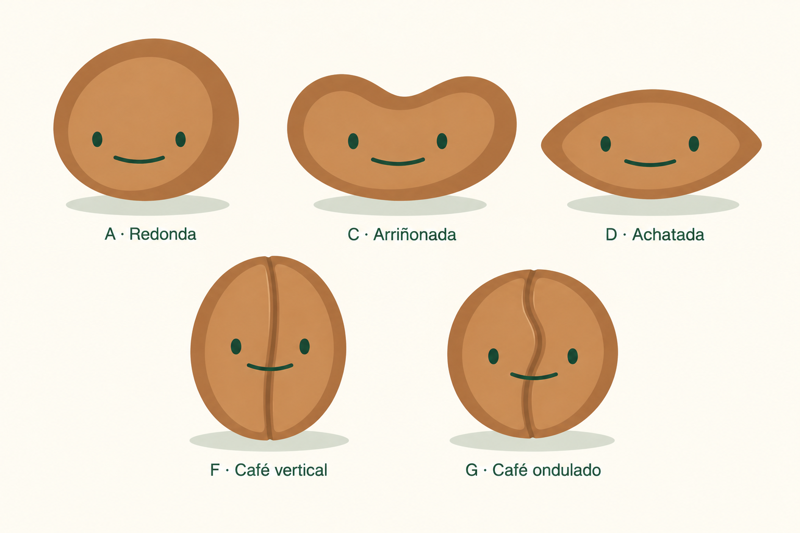

# Semillas reservadas para el futuro

12 de octubre de 2026.

La **B · Almendrada** es la forma elegida para la app. Las cinco variantes de esta lámina se conservan como propuestas para el futuro, igual que la exploración de raíces. **E · Picos curvos** queda descartada.

| Variante | Estado y ajuste |
| --- | --- |
| A · Redonda | Conservar para el futuro. |
| C · Arriñonada | Conservar la forma propuesta. |
| D · Achatada | Menos anchura y puntas ligeramente redondeadas. |
| F · Café vertical | Grieta más estrecha y con menos contraste; la cara tiene prioridad. |
| G · Café ondulado | Mismo ajuste de discreción en la grieta, conservando su curva. |

Las láminas iniciales `seed-variations-exploration.png` y `seed-variations-exploration-v2.png` se conservan como historial; sus archivos de notas registran los prompts originales. No implican aprobación de E ni sustituyen la selección de B.

## Semilla de la app

`bodies/seed.svg` adapta B a la ilustración SVG de la familia: cuerpo marrón almendrado, plano frontal más claro y borde oscuro. El componente aporta la cara SVG común exacta, las expresiones, la sombra independiente y el movimiento. Se mantiene la escala del 94% y la calibración facial vigente. `seed.svg` conserva el arte anterior como referencia histórica.

## Generación de la lámina futura

Herramienta integrada de imágenes, sin CLI ni API propia. Referencias: las dos láminas iniciales. Revisada visualmente: incluye solo A, C, D, F y G; D es más estrecha y tiene puntas suaves; las grietas de F y G son más discretas.

Prompt utilizado:

Use case: precise-object-edit. Create ONE consolidated reference sheet for future Reedleaves seed mascot options from two supplied concept sheets. Preserve the exact art style, warm tan-brown palette, dark forest-green widely spaced small oval eyes and thin shallow smile, light inset body surface, darker offset rim and cream background. This is a surgical refinement and rearrangement of approved proposals, not a redesign. Include exactly FIVE characters with their original letters. Top row: A, C, D. Bottom row centered: F, G. Labels below each character ONLY: "A · Redonda", "C · Arriñonada", "D · Achatada", "F · Café vertical", "G · Café ondulado". No heading or other text. A and C come from reference image 1: preserve their exact round and wide kidney body silhouettes and face. D, F, G come from reference image 2 with specific changes: D should have its width reduced by about 18 percent relative to its current width, while keeping its height, a broad horizontal almond shape and both end tips. Round and soften the two tips slightly so they feel friendly and less sharp, while remaining visibly tapered at both ends. D must remain squat and pointed, not a circle. F retains its exact upright oval shape and lovely nearly straight vertical central coffee-bean groove running top to bottom. Make ONLY the groove a bit more discreet: reduce its width by approximately 35 percent, soften its contrast from very dark brown to medium warm brown close to the rim; retain a delicate light bevel so the depth is still visible. G retains its exact rounder asymmetrical silhouette and lovely S-shaped VERTICAL central groove top to bottom. Make ONLY its groove narrower and less contrasty by the same amount as F. For F and G the FACE must visually dominate the groove; keep both oval eyes and the single shallow dark-green smile unchanged. Do NOT erase or conceal the full-length groove: keep it readable, elegant and continuous. No B (it has been selected for the app), NO E (discarded). No other characters. Each seed floats slightly above a separate consistent faint green-gray ground ellipse. Five similarly sized drawings, generous margins, clean balanced landscape presentation, two rows, no decorative panels. Avoid adding any leaves, arms, legs, cracks to A C D, eyebrows, cheeks, noses, pupils or open mouths. Do not change the source drawings beyond D's narrower softer tips and F/G's discreet grooves.

