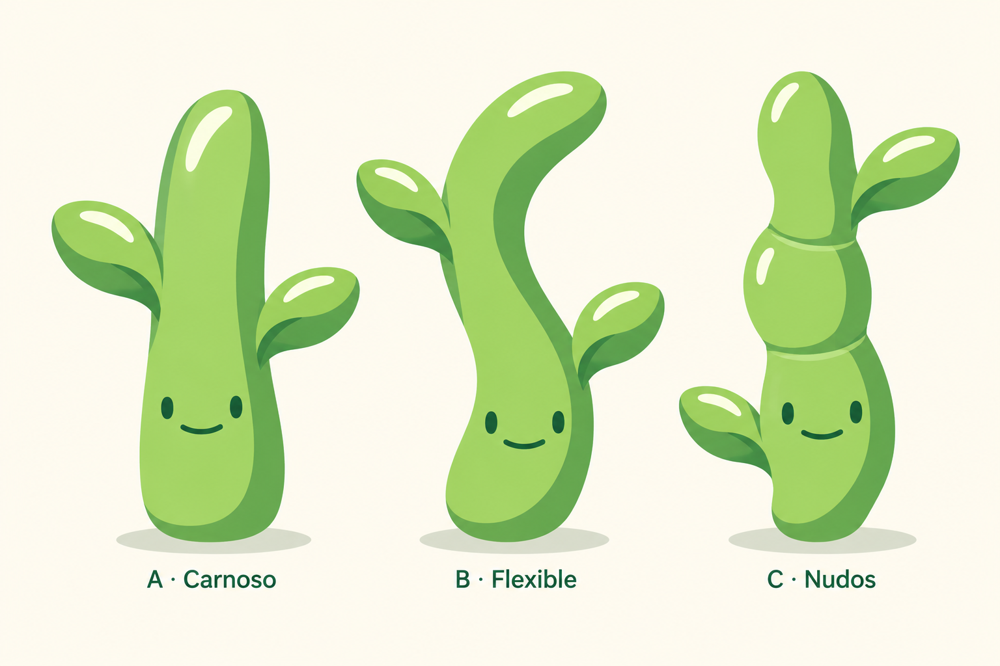

# Tallo — Tres direcciones

14 de octubre de 2026. Primera exploración solicitada por el usuario. **A · Carnoso elegida para desarrollar Tallo con el componente y el editor de calibración.** La lámina completa se conserva como exploración; B · Flexible y C · Nudos quedan como alternativas.



## Criterio

El usuario pide explorar Tallo a partir del estilo ya desarrollado, incluidas las variantes. Se toman como referencias visuales las semillas reservadas, las macetas y Brote A · Tierra v3. Las referencias orientan el estilo; no implican elegir sus formas para esta etapa.

Se conserva la cara sencilla de ojos pequeños separados, sonrisa cerrada, curvas orgánicas, verdes vivos, planos de sombra amplios, brillos claros y sombra de suelo independiente visualmente. El cuerpo protagonista es el propio tallo verde, con hojas laterales de apoyo. Las tres propuestas cambian la estructura, no solo las proporciones.

| Propuesta | Concepto | Lectura inicial |
| --- | --- | --- |
| A · Carnoso | Tallo recto, continuo y ancho; dos hojas laterales. | Es la opción más simple, aunque puede recordar a una suculenta. |
| B · Flexible | Tallo continuo curvado, con hojas a distintas alturas. | Alternativa conservada. La curva aporta gesto y una silueta propia. |
| C · Nudos | Tres tramos unidos, cambios de anchura y articulaciones suaves. | Es la más distinta, pero las juntas acercan la lectura al bambú y añaden detalle. |

La lámina se revisa visualmente: tres personajes, etiquetas correctas, cara en el tallo y diferencias claras de silueta. La generación resulta más alargada que la proporción indicada en el prompt; deberá revisarse si se desarrolla una dirección. El acabado incluye transiciones suaves y la cara es una aproximación raster, no la geometría SVG compartida exacta.

El antiguo `stem.svg` se conserva como histórico. El componente compartido usa ahora `bodies/stem.png`, un derivado de A sin cara ni sombra generado con la herramienta integrada de imágenes. Conserva la dirección elegida; es una extracción generativa, no una copia de píxeles garantizada. La cara SVG común, la sombra y el movimiento se componen por separado. Tallo aparece en el editor con sus trece parámetros. El 15 de octubre de 2026 el usuario aprueba desbloquear Tallo tras gastar hojas en diez días distintos, acumulados entre todas las barajas del mismo libro y sin exigir días consecutivos.

## Derivado de A · Carnoso

Archivo del cuerpo: `bodies/stem.png` (PNG RGBA de 1254 × 1254). Generado con la herramienta integrada de imágenes a partir de la lámina completa. La lámina original permanece intacta.

Calibración inicial: cuerpo x 0 %, y −5 %, escala 0,92; sombra 34 %; cara x 77, y 110, giro 0°, escala 0,4; ojos sin offsets; boca 4,25×. Son valores de partida para el editor, no una calibración final enviada por el usuario.

Prompt de extracción:

```text
Use case: precise-object-edit / background-extraction. Extract ONLY character A, the LEFTMOST "Carnoso" straight fleshy green stem from this supplied Reedleaves concept sheet. The chosen design must be preserved, do not redesign, reinterpret, shorten, thicken or bend it. Output ONE isolated BODY with genuine transparent background, on a square canvas. Preserve A's exact organic silhouette, tall straight rounded stalk, left leaf at upper-middle and right leaf slightly lower, their attachments, all lime green front planes, medium green side planes, white/ivory highlights and existing gentle color transitions. Keep original relative proportions of stem and leaves. REMOVE ONLY A's two dark oval eyes and small dark smile, smoothly restoring the underlying light green front surface; we will add the actual SVG face separately. Remove the entire ground shadow, label, cream background and all of B and C. No eyes, mouth or ground shadow should remain in the output. Keep the outer subject pixels opaque with smooth antialiased edges, no translucent body, no cream halo, no checkerboard baked in. Center the whole A body on the square canvas, fit its height to about 86% of the square, with equal top/bottom margins and sufficient side margins to fit both leaves. Keep the chosen artwork as closely as possible, especially its existing characteristic tilted rounded tip and asymmetrical leaf placements. No new elements, no text, no face, no shadows.
```

## Generación

Herramienta integrada de imágenes (`image_gen`), sin CLI ni API propia. Referencias:

- `seed-variations-future.png`
- `pot-variations-future.png`
- `brote-variations-a-tierra-v3.png`

## Prompt utilizado

```text
Use case: stylized-concept.
Asset type: ONE concept comparison sheet for the Reedleaves mascot family, exploring the stage "Tallo" (Stem).
Input images are STYLE REFERENCES ONLY, not edit targets. Image 1: the seed variant family, for warm minimal character rendering, tiny widely spaced solid forest-green eyes, shallow closed smile, light front plane and colored darker underside. Image 2: flowerpot variants, same family facial simplicity and dimensional colored planes. Image 3: selected Brote soil-and-leaves VARIANT, for rounded organic leaves, one green underside shade and broad ivory-white leaf highlight. Create entirely new Stem concepts, not another seed or plant-in-soil.
Produce a clean landscape reference sheet with exactly THREE LARGE friendly characters in one row, equally spaced, same apparent visual weight, all on a plain warm cream #FFF9ED backdrop with generous margins. Their baselines align. The only text is a short dark forest-green label below each: "A · Carnoso", "B · Flexible", "C · Nudos". No heading, subtitle, badges, panels or decoration.
Shared design: the MAIN BODY AND FACE ARE THE GREEN STEM ITSELF. Each stem is thick enough to have its own clear readable front face, plump, tactile, softly rounded ends. A stem with supporting small leaves, not a big round seed with a skinny stalk emerging, not an anthropomorphic human, not a tree trunk. Height roughly 1.5 to 1.8 times main body width, with leaf protrusions giving a balanced total silhouette. Bright living greens #B9E877 #83BD4D #58BE59 with one darker side/underside plane #369247, forest-green #173D2C face. Very small equal solid vertical oval eyes widely spaced across the main front stem, tiny thin shallow closed smile centered below, smile narrower than eye spacing. No eye glints, pupils, brows, blush, nose or open mouth. Organic asymmetry, bold simple contours. A small separate muted green-gray oval ground shadow sits underneath each, with a little floating gap.
A · Carnoso: upright wide fleshy continuous stem, softly tapered upper end and broad rounded lower end, like a tender succulent plant shoot. Clearly a long rounded green stalk, not a round blob. TWO modest rounded oval side leaves emerge near the upper third at slightly different heights; stem continues visibly above and below their attachment. Upper stem tip a simple closed rounded tip, not a pointed asparagus spear. Face in broad lower-middle stem plane. One light broad front and one medium green side plane, small ivory curved highlight at the upper front.
B · Flexible: one continuous chunky green stem making a gentle and clearly visible S-curve, with friendly bend and a rounded tip leaning to the side. Two small rounded leaves attached at different heights, following the gesture. No loops or spirals. The stem width remains substantial all along, the lower half stays broad enough for a normal widely spaced face; no big ball at base. Face on lower-middle of the continuous green stem. Shape, balance and gesture must be clearly different from A.
C · Nudos: green stem with THREE softly swollen connected internodes, integrated into one continuous vertical organism. Gentle waist changes between sections, one or two subtle horizontal curved joint marks, not three stacked balls, no discs or harsh rings. Slightly alternating leaf positions: one small leaf on lower side and one near top opposite side. Face centered on the broad middle-lower section. Rounded closed growing tip, green all over. Silhouette must read as a young living stem with nodes, NOT bamboo wood, cactus, caterpillar, or segmented toy.
Style: polished simple vector-like mascot concept art consistent with the reference family, clean colored planes with at most very gentle tone transitions like the flowerpot sheet, one broad medium green shaded underside per leaf, a small clean ivory-white curved highlight on leaves. No extra darkest exterior rim on leaves, no heavy outlines. Charming, calm, expressive, substantial and readable at small mobile sizes. All three must retain the reference family's quiet face and friendly personality while offering genuinely distinct body concepts.
Avoid: pots, soil, roots, brown seed bases, blossoms, fruits, tree bark, wood grain, spines, serrated leaves, intricate leaf veins, limbs, feet, hands, anthropomorphic arms, accessories, books, sparkles, realistic materials, plastic 3D, photorealism, noisy texture, dramatic gradients, black outlines, neon colors, extra characters, large eyes or decorative copy.
```
